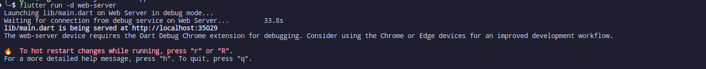

# In progress...

<!-- Intro -->

ChatApp is a web application created using Flutter and Dart. The application is made with Web3 technologies in mind and the security that the future might provide us in using cryptocurrencies on our everyday life, at least hypothetically... no one knows for sure. 


## Prerequisities

- [Flutter](https://docs.flutter.dev/get-started/install)
- [Dart](https://dart.dev/get-dart)
- [MetaMask extension](https://metamask.io/download/)
- Web3 supported browser like Chrome, Firefox, Brave to name a few examples

### After having all of the prerequisites you can follow the guide ⬇️:

---

<!-- User steps -->

### Step 1

Open [ChatApp](https://gen1-m.github.io/chat-app-web3/) in your Web3 supported browser.

### Step 2

Choose whether to have a demo or actually use the app. 
If you choose the demo, then don't read anymore, just enjoy the demo's presentation of the app. 
If you want to actually chat in Web3, then read more below. 

### Step 3

Connect your Metamask account by foloowing the instructions on Metamask extension.

### Step 4

Make sure to change the chain on your account to Sepolia server. 
Sepolia is a test server I used for this project. 

### Step 5 

Happy chatting in Web3! 

<!-- Developers steps -->

## Developers

### Step 1

Run flutter in your Web3 supported browser locally.

```bash
flutter run -d web-server
```

You should get something like this:



### Step 2

Click on `http://localhost:your-unique-port` link to open the application in your default browser, if it's a web3 browser. In case it is not, just copy the link and paste it to a web3 browser.

### Step 3

Click on the button and follow the steps on Metamask to connect your account or 
just click on demo to take a look at how the app works.

### Step 4

If you choose to connect the account then, make sure to choose Sepolia server (if the server does not show then click "Enable test servers").

### Step 5

Happy chatting in Web3! 🤗
